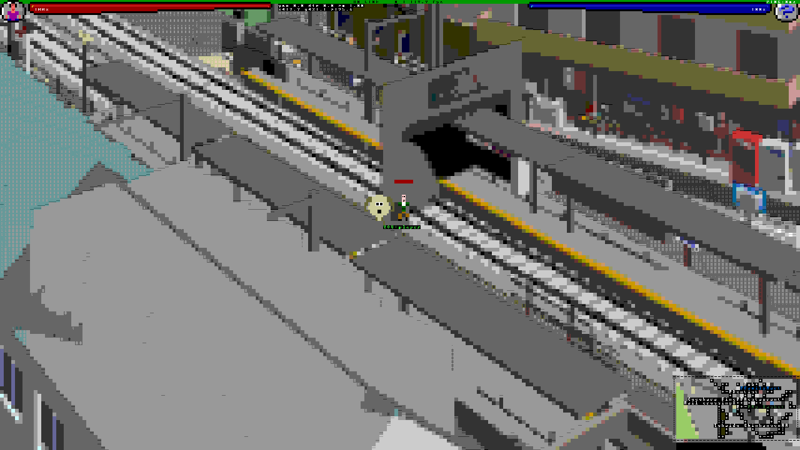
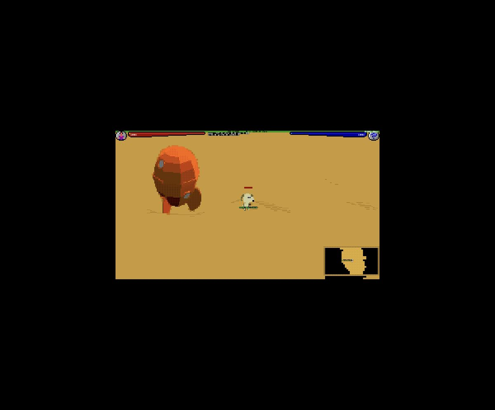
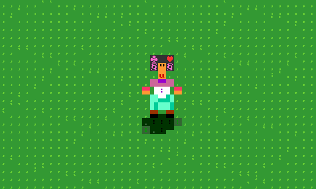
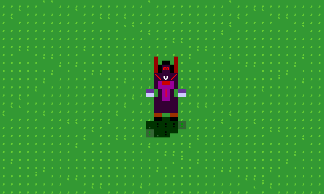
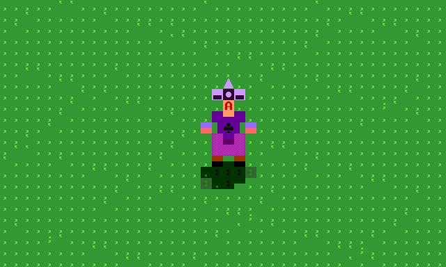
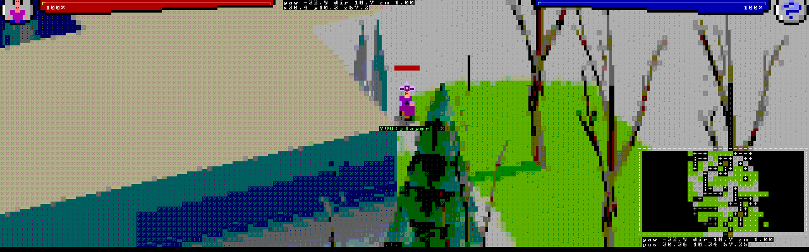
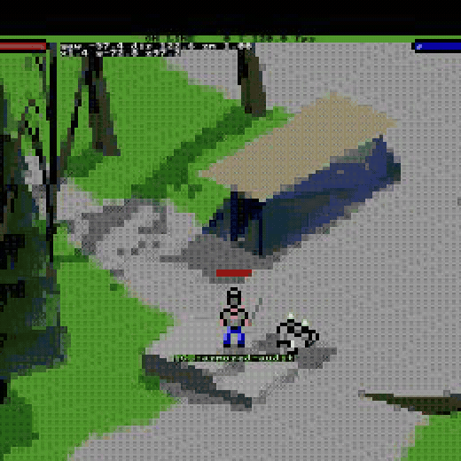

# Asciicker Y9-2 Runtime

A fork of [msokalski/asciicker](https://github.com/msokalski/asciicker), a CP437 3D ASCII engine.

This repository contains the Y9-2 C++ runtime: a multiplayer server, terminal
client, WebAssembly client, maps, meshes, audio, sprites and actor appearance
tools. The 3D glyph renderer is being refactored.

The renderer keeps the original CP437 byte-cell path for glyph IDs `0..255`. Y9-2 also supports manifest-declared extended glyph IDs through an extended-glyph sidecar, so the current runtime is not limited to CP437 even though that remains its compatibility fast path.

## Numabe map and HTML editor



Native runtime recording. The saved map has changed since this capture.

The Numabe workspace includes an A3D map, meshes, signs, train routes and a
browser editor. Switch between the Classic walk view, geometry preview,
overhead view and street reference overlays.

```bash
python3 -m pip install -r numabe/requirements-editor.txt
make numabe-check
make numabe-editor
# Open http://127.0.0.1:8792/
```

Classic uses a trailing walk camera. The eye-level geometry preview is an
editing aid, not first person CP437 gameplay.

The Numabe editor and its Classic runtime dependencies are in `numabe/`.

The saved map can be loaded and edited without downloading the original
PLATEAU terrain surveys or LiDAR point clouds. To reconstruct the map from
those measurements, use the acquisition URLs and hashes in the source manifest.

Run `make numabe-test` to test the map and editor. The optional
`make numabe-source-verify` also requires the original survey downloads.
Install `requirements-test.txt` for the test suite, including OpenCV/SciPy.
The scope-geometry tests additionally need GDAL's Python bindings matching
the native GDAL installation (on Ubuntu, install `libgdal-dev gdal-bin`, then
`python3 -m pip install "GDAL==$(gdal-config --version)"`). The saved-map HTML
editor itself only needs `numabe/requirements-editor.txt`.

## Sprites and animations










## Actor appearance and tools



[Detailed equipment-layer transition recording](docs/recordings/cp437-runtime-layer-transitions.gif)

Actor appearance is compiled from REXPaint `.xp` layers into runtime profiles.
The server selects the appearance state and the client combines the matching
layers. The bundled sprites include bodies, armor, helmets and weapons.

The runtime adds weather, minimaps, projectiles, crossbows, non Euclidean
geometry, placeable blocks and multiplayer changes to Gumix's Y9-2 release.
The tools include OSM to A3D conversion, picoCAD integration, a headless
CLI, Blender tools for A3D and AKM authoring, sprite rigs and the asciiid editor.
Engine components are split into modules rather than kept in `game.cpp`.


## Runtime layout

The repository has three main executable surfaces:

1. The authoritative server simulates the game and owns multiplayer state.
2. The native client runs the game in a terminal.
3. The browser client uses WebAssembly and connects to the server over WebSocket.

The repository also includes the map and asset formats, actor-appearance compiler inputs and generated tables, glyph manifests and atlases, and standalone contract tests used by those runtime paths.

## Build

The top-level `Makefile` wraps the supported build commands:

```sh
make server
make terminal
make web
make test
```

The browser build uses Emscripten 4.0.21. The Linux server build needs PulseAudio development headers. The macOS terminal build uses Homebrew V8.

On Linux without the vendored V8 monolith, the terminal client can link the V8 bundled with Node.js instead: `apt-get install libnode-dev`, then `make terminal V8_FROM=system` (or `V8_FROM=auto`). The client needs a PulseAudio server at startup. `scripts/terminal_capture/capture.py` records a headless tmux session to a GIF.

## Run

Start the server:

```sh
make server
make run-server
```

For the browser client, build and serve it in another terminal:

```sh
make web
make serve-web
```

Then open `http://127.0.0.1:8765/` and connect to `ws://127.0.0.1:8080`.

For the native terminal client:

```sh
make terminal
make run-terminal
```

The repository's GitHub Actions workflow is configured to run the standalone checks, build the server on Linux, build the terminal client on macOS, and build the WebAssembly client on Linux.

## Source and licensing

See [docs/ATTRIBUTION.md](docs/ATTRIBUTION.md) for upstream and Y9-2 source identities, asset provenance, and licensing information. The original Asciicker source license is preserved under `docs/licenses/`.
